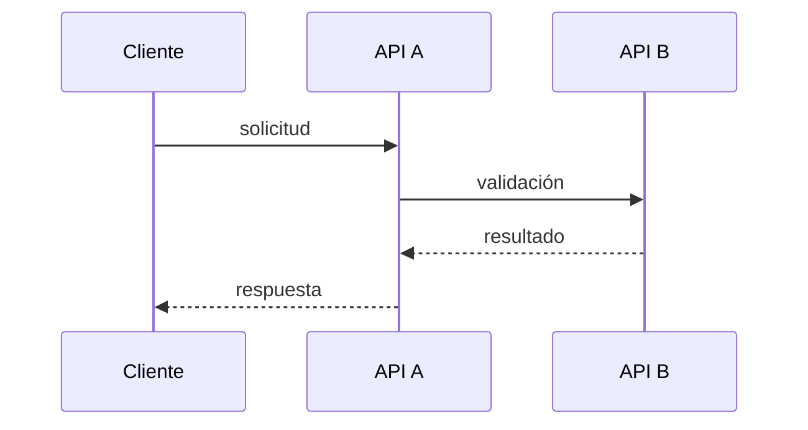

# Plantillas

Índice: AGENTS.md mínimo · ADR · Gotchas · Dominio · Overview con Mermaid

## AGENTS.md mínimo

Debe ser corto: es lo que se carga siempre. Detalle en `docs/`.

```markdown
# <nombre-del-repo>

<Qué hace este repo y cómo encaja en el sistema, en 2-3 líneas.>
**Equipo dueño:** <equipo> · **Depende de:** <apis/servicios> · **Lo consumen:** <quiénes>

## Comandos
- Build: `<comando>`
- Tests: `<comando>`
- Run local: `<comando>`

## Reglas clave
- <Regla concreta y accionable. Qué NO hacer y por qué, en una línea.>

## Documentación: cuándo leer cada archivo
- `docs/domain.md`: leelo antes de tocar lógica de negocio o si ves un término que no entendés.
- `docs/decisions/`: leelo cuando vayas a cambiar una decisión de arquitectura o te preguntes "¿por qué se hizo así?".
- `docs/gotchas.md`: leelo si algo falla de forma rara o antes de cambiar el manejo de errores.

## Contexto superior
- Si tu tarea toca otro servicio del proyecto o necesitás el flujo completo: <link docs del proyecto>.
- Si necesitás saber qué expone otra API o quién es responsable de qué: <link catálogo GitLab Pages>.

## Mantenimiento de la documentación
Al terminar una tarea, ejecutá la skill `document-task`. Si no está disponible: actualizá los docs afectados, creá un ADR si hubo decisión con alternativas y agregá gotchas nuevos.
```

Incluí solo las líneas de "cuándo leer" de archivos que existen.

## ADR (`docs/decisions/NNN-titulo-corto.md`)

```markdown
# NNN. <Decisión en una frase>

- Estado: aceptada | reemplazada por NNN | borrador
- Fecha: AAAA-MM-DD

## Contexto
<Qué problema o restricción había. Datos concretos: volumen, plazos, dependencias, reglas de negocio.>

## Decisión
<Qué se decidió, en términos concretos.>

## Alternativas descartadas
- **<Alternativa A>:** <por qué no.>
- **<Alternativa B>:** <por qué no.>

## Consecuencias
<Qué queda más fácil, qué queda más difícil, qué hay que vigilar.>
```

Si el motivo o las alternativas no los confirmó el dev, marcá la sección con `> Borrador: sin verificar`.

## Gotchas (`docs/gotchas.md`)

Una entrada por trampa, formato fijo:

```markdown
## <Síntoma o situación, en una línea>
- **Qué pasa:** <comportamiento no obvio.>
- **Por qué:** <causa, si se conoce.>
- **Qué hacer:** <acción concreta.>
- **Dónde:** `<ruta/al/archivo>`
```

Ejemplo: "La API B devuelve 200 aunque falle: revisar `status` en el body".

## Dominio (`docs/domain.md`)

```markdown
# Dominio

## Glosario
- **<Término de negocio>:** <definición>. Se mapea a `<Clase/tabla>`.

## Reglas de negocio
- **<Regla>:** <qué se cumple y por qué existe (regulación, acuerdo, historia).> Implementada en `<ruta>`.

## Invariantes
- <Lo que nunca debe ocurrir.>

## Estados y transiciones
<Diagrama Mermaid stateDiagram-v2 + texto con las reglas y excepciones de cada transición.>
```

## Overview con Mermaid (`docs/overview.md`)

```markdown
# Overview

<Qué problema resuelve este componente y su flujo principal, en 3-5 líneas.>

## Flujo principal


**Reglas del flujo**
- <Qué pasa si B falla, timeouts, reintentos, orden obligatorio, idempotencia.>

**Por qué es así**
- <Enlace al ADR que lo justifica.>
```

Reglas del diagrama: un diagrama por concepto, pocos nodos, y el texto al lado lleva las reglas y los motivos.
